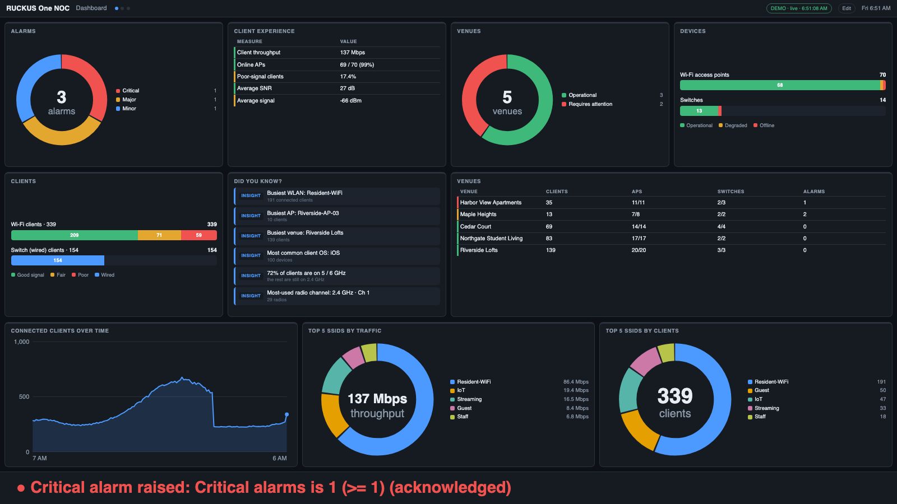
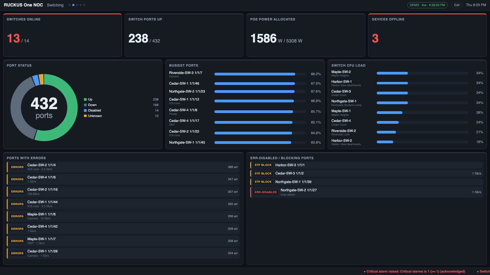
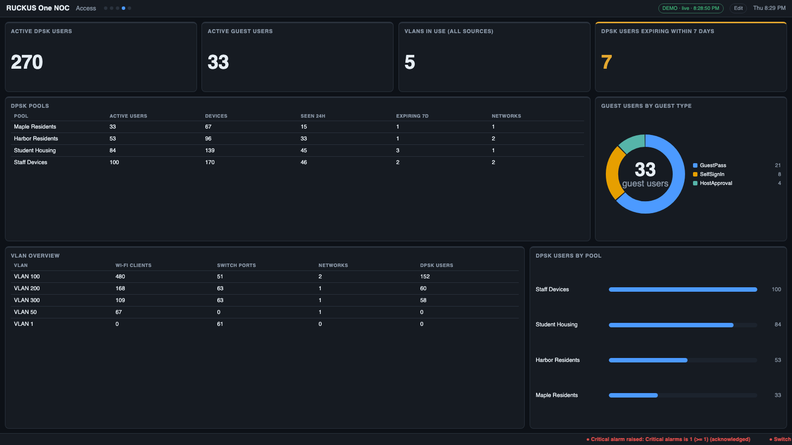

# R1 NOC

A **server-side NOC wall display for RUCKUS One**. One small Node.js server polls the RUCKUS One public API; any browser
on your network — wall TVs, kiosks, laptops — shows live, customizable dashboards. Design screens in a built-in
editor, get full-screen alerts and Slack/Teams/email notifications, and receive scheduled reports.



- **No dependencies, nothing to install** beyond Node.js 22.5+ (uses the built-in `node:sqlite`).
- **Browsers hold no credentials** — only the server talks to RUCKUS One, with a read-only API key.
- **900+ widgets** (clients, APs, switches, ports, alarms, DPSK, guests, VLANs, Wi-Fi calling, throughput, RF quality gauges, history…), searchable,
  auto-tiled to fill any screen size.

## Quick start

```bash
git clone <this-repo> r1-noc && cd r1-noc
npm run demo          # synthetic data, no credentials needed → http://localhost:8080
```

Then connect your tenant: `npm start`, open <http://localhost:8080/admin>, fill in **R1 connection**, press
**Test connection**. Full walkthrough: **[Getting started](docs/GETTING_STARTED.md)**.

## Documentation

| | |
|---|---|
| **[Getting started](docs/GETTING_STARTED.md)** | install, API key, connect, build screens, put it on the wall — about 15 minutes |
| **[User guide](docs/USER_GUIDE.md)** | the viewer, editor, widgets, alerts, notifications, multi-display, views & schedules, history, reports, security, troubleshooting, reference |

## Looks like RUCKUS One out of the box
The three default screens are modelled on RUCKUS One's own **Dashboard**, **Wi-Fi (Wireless / WLAN) report** and
**Switch (Wired) report** — same tiles, same names, so it feels familiar on a wall:

| | |
|---|---|
| **Dashboard** | Alarms ring · Client Experience · Venues ring · Devices bars · Clients bars · "Did you know?" · Connected Clients Over Time · Top 5 SSIDs by Traffic / by Clients |
| **Wi-Fi** | Top APs by Traffic / Client Count · Top SSIDs by Traffic / Client Count · Traffic Trend · Active SSIDs Trend · Top APs / Top SSIDs tables |
| **Switch** | Top Switches by Traffic / PoE Usage / Errors · Traffic by Switch Model and Port Speed · Traffic Trend · Error Trend · Overview |


Tiles that need RUCKUS AI / analytics data (Incidents, Connection Success, Time To Connect, AP Capacity, Top Applications,
airtime) aren't available from the public API and are left out. Everything is editable, and the old Overview / Clients /
Infrastructure screens are still available as presets.

## What you get

| | |
|---|---|
|  | **Live operational screens** — switching, ports, PoE, clients, APs, alarms, venue health. Screens auto-rotate; Hold / step / jump from any display. |
|  | **Alerts that can't be missed** — rules like *"switch offline for 2 min"* take over every display until acknowledged, and notify Slack, Teams, email or a webhook. |
|  | **Access & identity** — active DPSK users, guest passes, VLAN overview, Wi-Fi networks, identity groups. |
|  | **History** — now vs yesterday / last week, hour-of-day profiles, peak/average/change scorecards. |
|  | **Reports** — scheduled daily/weekly snapshots, saved, printable to PDF and emailed. |

Also: a **drag-and-drop layout designer** (reorder or place every chart exactly where you want it), **per-display playlists**, a **scrolling ticker** for custom messages, news, weather and stock quotes (or a full-screen sign), **measured client throughput and traffic** (from counter deltas), **AP-group and radio/channel views**, **multi-display video walls** (one screen spread across several monitors, all in sync), **views + schedules**
("After hours" layout 18:00–06:00), **venue drill-down**, scorecard **thresholds**, and a burn-in guard for TVs.

## Configuration in one table

| Variable | Default | |
|---|---|---|
| `R1_TENANT_ID`, `R1_CLIENT_ID`, `R1_CLIENT_SECRET` | | RUCKUS One API application (or enter them in the editor) |
| `R1_API_BASE` / `R1_OAUTH_BASE` | `https://api.ruckus.cloud` | region: `…eu.ruckus.cloud`, `…asia.ruckus.cloud` |
| `PORT` | `8080` | |
| `POLL_SECONDS` | `60` | minimum 15 |
| `NOC_VIEW_KEY` / `NOC_ADMIN_KEY` | | require `?key=` to view / to edit remotely |
| `NOC_DEMO` | | `1` = synthetic data |
| `NOC_DATA_DIR` | `./data` | settings, layout, history, reports |

Copy `.env.example` to `.env`, or use the editor. **`data/` and `.env` hold secrets and are git-ignored — never commit them.**

## Scope and honesty

- It reads RUCKUS One's **public REST API**. It does **not** show Data Studio dashboards (those only accept a logged-in
  user's token, not an API key), so per-application usage, Wi-Fi-calling call duration and long-range history are out of
  scope. See the [User guide](docs/USER_GUIDE.md#how-it-works).
- Core queries follow shapes confirmed on a live tenant; some field mappings were built from the published API schemas.
  After connecting, use the editor's **Diagnostics** button once to confirm them on your tenant
  ([details](docs/USER_GUIDE.md#limits-and-known-gaps)).
- Plain HTTP only — put it behind a reverse proxy for HTTPS ([Security](docs/USER_GUIDE.md#security)).

## Project layout

```
server.js       HTTP + live streaming, shared rotation clock, schedulers
lib/            collect · normalize · widgets · widgetgen · rules · notify · report · history · dashboard · demo
public/         viewer, editor, multi-display launcher
docs/           getting started, user guide, screenshots
```

Adding a widget is one entry in `lib/widgets.js` (or one field/measure in `lib/widgetgen.js`) — see the
[User guide](docs/USER_GUIDE.md#adding-your-own-widget).

---

*Unofficial tool — not an official RUCKUS / CommScope product. "RUCKUS One" is a product of its respective owner.*
