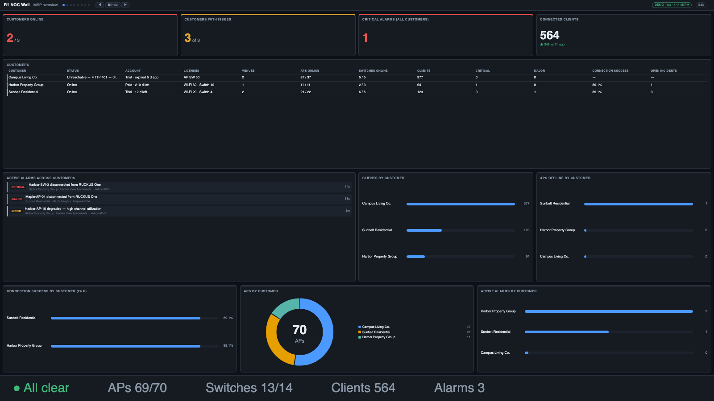
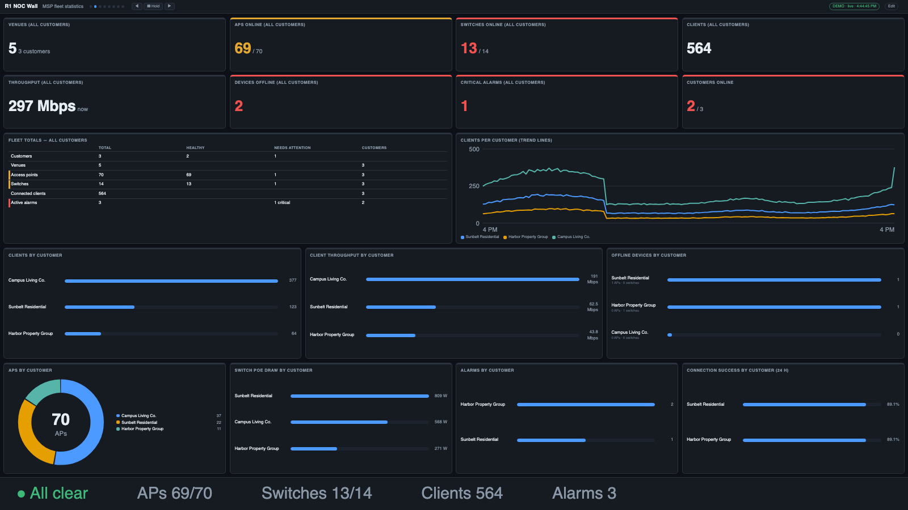
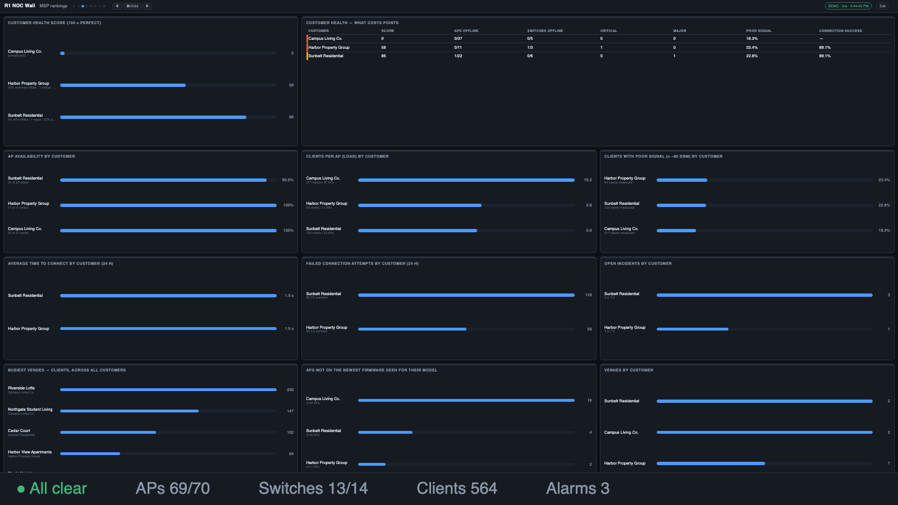
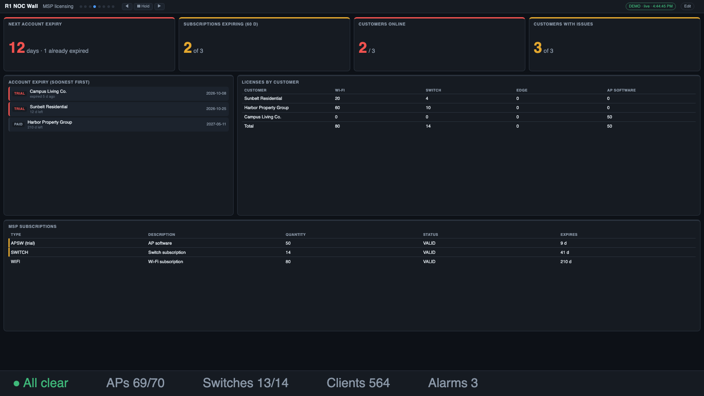
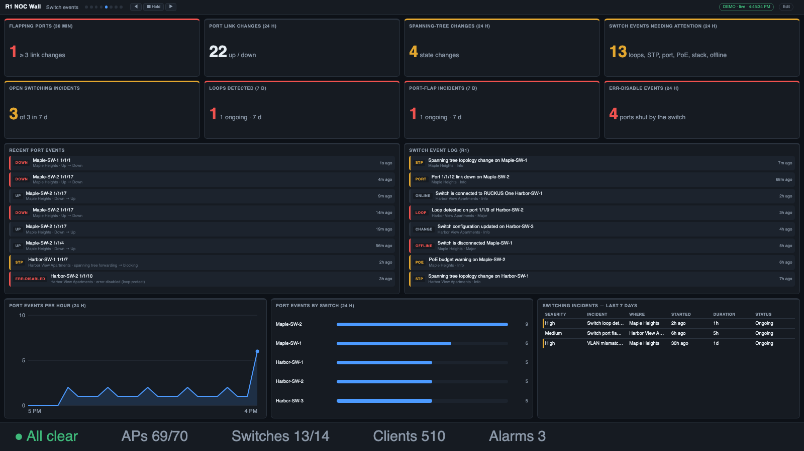
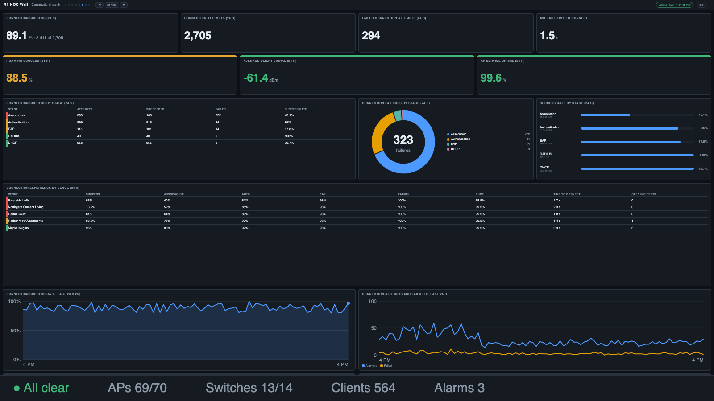
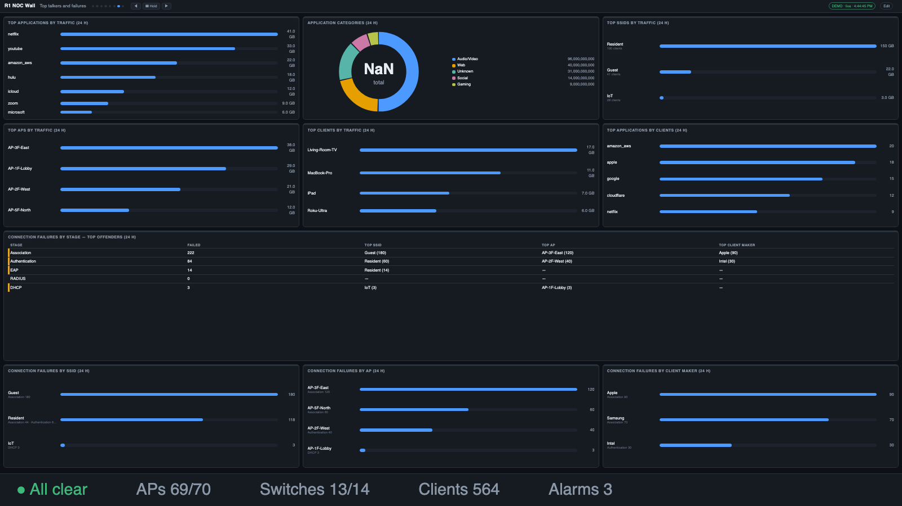
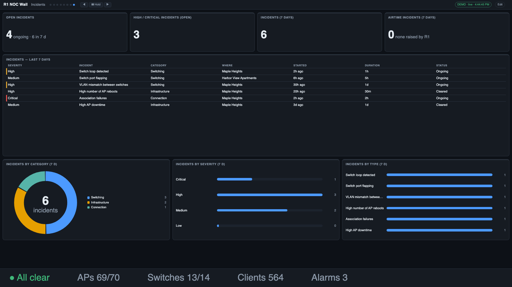

# R1 NOC Wall

A **server-side NOC wall display for RUCKUS One** — for a single site or a whole managed-service business. One small server polls
RUCKUS One; any browser on your network (wall TVs, kiosks, laptops) shows live, customizable dashboards. Design screens in a built-in
editor, get full-screen alerts and Slack / Teams / email notifications, receive scheduled reports, and — as an MSP — see every
customer on one wall.


## Highlights

- **Looks and feels like RUCKUS One** — the default screens mirror R1's own Dashboard, Wi-Fi and Switch reports; 1,100+ widgets
  (clients, APs, switches, ports, alarms, DPSK, guests, VLANs, Wi-Fi calling, throughput, RF quality, history…), auto-tiled to any screen,
  plus a drag-and-drop layout designer.
- **MSP mode** — connect **one MSP key** (R1's delegated access) and the app discovers every customer, or add a key per customer.
  Customer filter on every widget, fleet-wide statistics, customer health score and rankings, license and trial-expiry tracking,
  customer-named alerts, and a wall per customer (`?customer=`).
- **Switch events** — flapping ports, port link changes, spanning-tree changes, err-disable events (from the app's own port polling),
  R1's switch event log, and loop / port-flap / DDoS incidents.
- **Client experience** (experimental) — connection success by stage (association → DHCP), time to connect, incidents, top applications,
  failures by SSID / AP / client maker, roaming, per venue.
- **Alerts that can't be missed** — rules take over every display until acknowledged, and notify Slack, Teams, email or a webhook.
- **Built to run unattended** — HTTPS and certificate management, editor sign-in, credential-free or encrypted configuration backup,
  in-place upgrade from a downloaded file with a start-up test and one-click rollback.
- **No dependencies** beyond Node.js 22.5+ (built-in `node:sqlite`). Browsers hold no credentials; use a **read-only** API key.

## Ways to run it

| | |
|---|---|
| **Virtual appliance (.ova)** | Import into VMware ESXi / Workstation / Fusion, VirtualBox or Proxmox, power on, open the address on the console and sign in as `noc`. HTTPS on 443 out of the box. DHCP by default; for a **static IP** log in at the console and run `sudo r1-noc-config` → *Network*. |
| **macOS app (.dmg)** | Drag to Applications; lives in the menu bar. Node.js is bundled (Apple silicon and Intel). |
| **Windows (setup.exe or portable .zip)** | Per-user installer, or unzip and run `R1-NOC-Wall.exe`. Node.js is bundled. *(Not yet tested on a real Windows machine.)* |
| **From source** | `git clone`, `npm start` (Node.js 22.5+). |

All of them update in place from a downloaded release file (editor → *Software update*). Downloads are on the
[Releases page](../../releases). Details: [Installing](docs/USER_GUIDE.md#installing-the-appliance-mac-app-and-windows-app) and [packaging/](packaging/README.md).

## Quick start

1. **Download** the appliance, Mac app or Windows installer from the [Releases page](../../releases) — nothing else to install (no Node.js, no git).
2. Open the editor, choose **How do you connect to RUCKUS One?** under **R1 connection** (one account, one MSP key, or a key per customer), fill it in and press **Test connection**.
3. Add screens, put the wall address on a TV.

Step-by-step for each option: **[Getting started](docs/GETTING_STARTED.md)**.

**From source** (Linux, Raspberry Pi, developers — Node.js 22.5+ required):

```bash
git clone <this-repo> r1-noc && cd r1-noc
npm run demo          # synthetic data, no credentials needed → http://<server-ip>:8080
npm run demo:msp      # …or a pretend three-customer MSP
npm start             # real data: open http://<server-ip>:8080/admin → R1 connection (the address is printed at start)
```

## Documentation

| | |
|---|---|
| **[Getting started](docs/GETTING_STARTED.md)** | install, API key, connect, build screens, put it on the wall — about 15 minutes |
| **[User guide](docs/USER_GUIDE.md)** | the viewer, editor, widgets, MSP mode, switch events, alerts, notifications, multi-display, views & schedules, history, reports, HTTPS, backup, updates, security, troubleshooting, reference |
| **[Packaging](packaging/README.md)** | building the appliance, Mac app and Windows installer |
| **[Changelog](CHANGELOG.md)** | what changed in each version |

## MSP mode — every customer on one wall



Choose **MSP — one key for all my customers** in **R1 connection**, enter an Application Token created in the MSP's own account, and the app lists
your customers (untick any you don't want). Or add a separate key per customer.


| | |
|---|---|
|  | **Fleet statistics** — totals across all customers, per-customer breakdowns of clients, APs, switches, alarms, throughput and PoE, and trend lines per customer. |
|  | **Rankings and health** — a customer health score (with what cost points), AP availability, load, signal, firmware lag, connection experience and incidents by customer. |
|  | **Licensing** — trial and account expiry, licenses per customer, MSP subscriptions, alerts before they lapse. |

## Switch events



Flapping ports, link changes, spanning-tree changes and err-disable events are detected from the app's own port polling (sampled every few
minutes, kept 7 days); R1's switch event log and its loop / port-flap / DDoS incidents are shown alongside.

## Client experience (experimental)

| | |
|---|---|
|  | **Connection health** — success by stage (association → DHCP), time to connect, daily trend. |
|  | **Top talkers and failures** — top applications / SSIDs / APs / clients, and who is failing at which stage. |
|  | **Incidents** — R1's incident list with counts by category and severity. |

These come from R1's own analytics service, which is undocumented but accepts API keys — so it may change without notice; if it stops working only these widgets say so.

## Looks like RUCKUS One out of the box
The three default screens are modelled on RUCKUS One's own **Dashboard**, **Wi-Fi (Wireless / WLAN) report** and
**Switch (Wired) report** — same tiles, same names, so it feels familiar on a wall:

| | |
|---|---|
| **Dashboard** | Alarms ring · Client Experience · Venues ring · Devices bars · Clients bars · "Did you know?" · Connected Clients Over Time · Top 5 SSIDs by Traffic / by Clients |
| **Wi-Fi** | Top APs by Traffic / Client Count · Top SSIDs by Traffic / Client Count · Traffic Trend · Active SSIDs Trend · Top APs / Top SSIDs tables |
| **Switch** | Top Switches by Traffic / PoE Usage / Errors · Traffic by Switch Model and Port Speed · Traffic Trend · Error Trend · Overview |


Airtime isn't reachable with an API key (R1 returns no airtime data); an **AP load** screen (busiest radios, channel load, per-AP load) is the
closest stand-in. The old Overview / Clients / Infrastructure screens are still available as presets.

## What else you get

| | |
|---|---|
|  | **Live operational screens** — switching, ports, PoE, clients, APs, alarms, venue health. Screens auto-rotate; Hold / ◀ ▶ controls and keyboard shortcuts. |
|  | **Alerts that can't be missed** — rules like *"switch offline for 2 min"* take over every display until acknowledged, and notify Slack, Teams, email or a webhook. |
|  | **Access & identity** — active DPSK users, guest passes, VLAN overview, Wi-Fi networks, identity groups. |
|  | **History** — now vs yesterday / last week, hour-of-day profiles, peak/average/change scorecards. |
|  | **Reports** — scheduled daily/weekly snapshots, saved, printable to PDF and emailed. |
|  | **Layout designer** — reorder or place every chart exactly where you want it, with real chart previews. |

Also: **per-display playlists** for multi-monitor walls, a **scrolling ticker** for custom messages, news, weather and market quotes,
**views and schedules** (e.g. an "After hours" layout 18:00–06:00), **venue drill-down**, scorecard **thresholds**, and a burn-in guard for TVs.

## Security

- Viewing is open unless you set a view key; the editor works from the server itself, with an admin key, or by **signing in** (the appliance's `noc`
  login, or an editor account you create — [details](docs/USER_GUIDE.md#signing-in-to-the-editor)).
- **HTTPS** with a self-signed or CA-signed certificate is built in ([details](docs/USER_GUIDE.md#https-and-certificates)); a failed update rolls back.
- Secrets (API keys, notification credentials) are stored on the server with owner-only permissions and are never sent back to a browser.
  **`data/` and `.env` are git-ignored — never commit them.**

## Configuration in one table

| Variable | Default | |
|---|---|---|
| `R1_TENANT_ID`, `R1_CLIENT_ID`, `R1_CLIENT_SECRET` | | RUCKUS One API application (or enter them in the editor) |
| `R1_API_BASE` / `R1_OAUTH_BASE` | `https://api.ruckus.cloud` | region: `…eu.ruckus.cloud`, `…asia.ruckus.cloud` |
| `PORT` / `HTTPS_PORT` | `8080` / `8443` | |
| `POLL_SECONDS` | `60` | minimum 15 |
| `NOC_VIEW_KEY` / `NOC_ADMIN_KEY` | | require `?key=` to view / to edit remotely |
| `NOC_DEMO` / `NOC_DEMO_MSP` | | `1` = synthetic data / pretend three customers |
| `NOC_DATA_DIR` | `./data` | settings, layout, history, reports |

Copy `.env.example` to `.env`, or use the editor (all of this is also under **R1 connection**).

## Scope and honesty

- It reads RUCKUS One's **public REST API**, plus R1's analytics service and event log (experimental, undocumented in places). It does **not**
  show Data Studio dashboards (those only accept a logged-in user's token), so airtime, Wi-Fi-calling call duration and long-range history are
  out of scope. See the [User guide](docs/USER_GUIDE.md#how-it-works).
- Core queries follow shapes confirmed on a live tenant; some field mappings were built from the published API schemas. After connecting, use
  **Diagnostics** once to confirm them on your tenant ([details](docs/USER_GUIDE.md#limits-and-known-gaps)).
- The Windows installer and zip have not yet been run on a real Windows machine.

## Project layout

```
server.js       HTTP(S) + live streaming, shared rotation clock, schedulers, sign-in
lib/            collect · analytics · normalize · widgets · widgetgen · rules · notify · report · history · dashboard · tls · backup · upgrade · auth · demo
public/         viewer, editor, login, multi-display launcher
docs/           getting started, user guide, screenshots
packaging/      appliance (OVA), macOS app and Windows installer builders
scripts/        package a release, offline upgrade, reset the editor password
```

Adding a widget is one entry in `lib/widgets.js` (or one field/measure in `lib/widgetgen.js`) — see the
[User guide](docs/USER_GUIDE.md#adding-your-own-widget).

---

*Unofficial tool — not an official RUCKUS / CommScope product. "RUCKUS One" is a product of its respective owner.*
