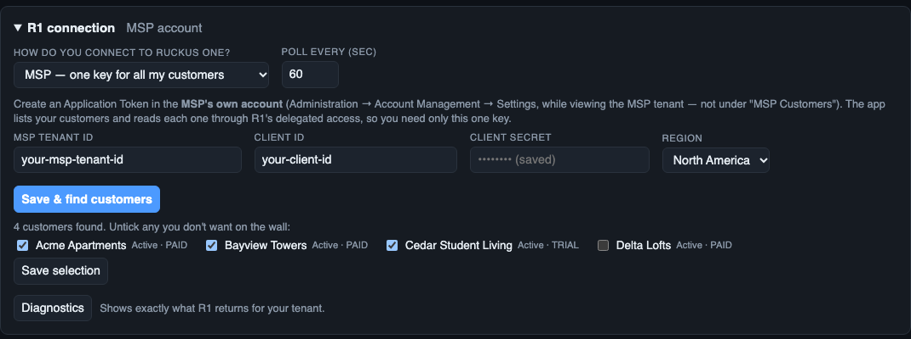

# Getting started

This gets you from nothing to a live NOC wall in about 15 minutes. You need a computer that stays on (a Mac, Linux box,
Raspberry Pi 4/5, a VM) and any browser for the display(s).

**Pick how you want to run it** (all are on the [Releases page](../../releases)):

| | Best for | Go to |
|---|---|---|
| **Virtual appliance (.ova)** | a VM host (VMware, VirtualBox, Proxmox) — nothing to install, HTTPS included | *Quick start: virtual appliance* below |
| **macOS app (.dmg)** | a Mac that stays on | drag to Applications, open it (menu bar "R1"), then step 3 |
| **Windows (setup.exe / .zip)** | a Windows PC that stays on | run the installer or `R1-NOC-Wall.exe`, then step 3 |
| **From source** | Linux, Raspberry Pi, anything with Node.js 22.5+ | steps 1–10 below |

> **Tip:** try everything first in **demo mode** (step 2). It needs no credentials and shows realistic synthetic data,
> so you can learn the editor before pointing it at your tenant.

## Quick start: virtual appliance (OVA)

If you downloaded the `.ova` instead of installing from source, you can skip steps 1–2 and 7–9:

1. Import the `.ova` into VMware / VirtualBox / Proxmox and attach it to your network.
2. Power on. The console shows the wall address (`https://<ip>/`) and the editor address (`https://<ip>/admin`) — sign in there as **`noc`** with the console password you set. It uses DHCP until you set a fixed address.
3. **Want a static IP?** Log in at the console as `noc` (password `noc`; you must change it), run `sudo r1-noc-config`, choose **Network → Fixed IP address**, then choose **Regenerate HTTPS certificate** so the certificate covers the new address.
4. Open the editor address and continue at step 4 below (*Connect the server to your tenant*). The same menu sets the host name and time zone, turns SSH on or off, and resets the editor key. Details: [Installing: appliance, Mac app, Windows](USER_GUIDE.md#installing-the-appliance-mac-app-and-windows-app).

---

## 1. Install

You need **Node.js 22.5 or newer** (it uses the built-in `node:sqlite`; there is nothing else to install).

```bash
node --version          # v22.5.0 or higher
git clone <your-repo-url> r1-noc
cd r1-noc
```

There is no `npm install` step — the project has no dependencies.

## 2. Look around in demo mode

```bash
npm run demo
```

Open <http://localhost:8080>. You'll see rotating screens of synthetic data (and a couple of demo faults, so you'll
also see the alert takeover). Click **Edit** (top right) to open the editor, or go to <http://localhost:8080/admin>.

Stop it with `Ctrl+C`. Demo mode keeps its history in a separate file, so it never mixes with real data.

## 3. Create a RUCKUS One API key

The server talks to RUCKUS One with an **API application** (client credentials). In RUCKUS One:

1. Go to **Administration → Account Management → API Keys** (menu names can differ slightly between releases).
2. **Add** a key. Give it a name like `noc-wall`.
3. Choose a **read-only role** — this app only ever *reads*. (See [Permissions](USER_GUIDE.md#permissions-and-the-api-key).)
4. Copy the **Tenant ID**, **Client ID** and **Client Secret**. The secret is shown once.
5. Note your **region**: North America `https://api.ruckus.cloud`, Europe `https://api.eu.ruckus.cloud`,
   Asia `https://api.asia.ruckus.cloud`.

## 4. Connect the server to your tenant

Start the server normally (no `NOC_DEMO`):

```bash
npm start
```

Open <http://localhost:8080/admin> and expand **R1 connection**:

| Field | What to enter |
|---|---|
| Tenant ID | from step 3 |
| Client ID / Client secret | from step 3 |
| Region | pick yours (fills in both URLs) |
| Poll every (sec) | `60` is a good default (minimum 15) |

The fields above are for the default choice, **One RUCKUS One account**. The first drop-down switches to MSP modes (shown below in *MSP — one key for all my customers*).



Click **Save connection**, then **Test connection**. You should see *"Connected — N venues: …"*.

> Prefer files over the GUI? Copy `.env.example` to `.env` and fill it in instead — see
> [Configuration](USER_GUIDE.md#configuration). Values saved in the GUI override `.env`.

The secret is stored on the server in `data/settings.json` (owner-readable only) and is never sent back to the browser.

> **Managing several customers (MSP)?** Use the first choice in **R1 connection** (*How do you connect to RUCKUS One?*) to switch to *MSP — one key for all my customers* — see [MSP mode](USER_GUIDE.md#msp-mode-multiple-customers). `npm run demo:msp` previews it.

## 5. Check the data looks right

Open <http://localhost:8080>. Within a minute the chip in the top bar should read **live**.

The first time you run against a real tenant, click **Diagnostics** (in the *R1 connection* panel). It shows exactly
what R1 returns — status values, field names, a sample row of each kind. If a widget shows zero or "Unknown" where it
shouldn't, that report tells you why. (A few field mappings were built from the API documentation but not yet
confirmed on every tenant; Diagnostics is how they get fixed in minutes.)

## 6. Build your screens

Go to **/admin**. The three starter screens — **Dashboard**, **Wi-Fi** and **Switch** — are modelled on RUCKUS One's own Dashboard, Wireless/WLAN report and Wired report, so they're a familiar starting point.

- **+ Add widget** opens a searchable catalog of 1,000+ widgets. Try searching `dpsk`, `vlan`, `poe`, `guest`, `ssid`.
- **Duplicate** or **Copy to** (screen header) makes a copy of any screen, here or in another view; rename it with the *Screen name* box.
- **+ Preset screen…** adds ready-made screens (RUCKUS One Dashboard / Wi-Fi / Switch, Overview (classic), Switching, **Switch events**, Wi-Fi Calling, AP load (airtime stand-in), Connection health / Top talkers and failures / Incidents (experimental analytics), Wireless performance, Student experience, RF coverage, Throughput, Client mix, and — for MSPs — **MSP overview, MSP fleet statistics, MSP rankings, MSP trends, MSP licensing**).
- Leave **Auto-fit (no gaps)** ticked and the screen tiles itself to fill the display.
- Click **Save & apply** — every open display updates immediately.

## 7. Put it on the wall

On the display computer, open the viewer in a browser and press **F** for fullscreen:

```
http://<server-address>:8080/
```

Tips for a kiosk:

- Chrome kiosk: `chrome --kiosk --app=http://<server>:8080/` (macOS: `open -a "Google Chrome" --args --kiosk http://<server>:8080/`).
- Use `?scale=1.25` to enlarge everything slightly for a distant TV.
- Several screens/monitors? See [Multiple displays](USER_GUIDE.md#multiple-displays-and-video-walls).

## 8. Turn on alerts (recommended)

In the editor, open **Alerts**. Six sensible rules are already there (critical alarm, switch offline, many APs offline,
switch CPU, PoE budget, stale data). Rules marked **Take over screens** cover every display with a full-screen banner
until someone acknowledges it.

To get alerts outside the NOC, open **Notifications**, add a channel (Slack, Teams, email or webhook), and press
**Send test**. See [Alerts and notifications](USER_GUIDE.md#alerts-and-notifications).

## 9. Keep it running

Run it under a process manager so it survives reboots. Templates for systemd (Linux) and launchd (macOS) are in the
[User guide](USER_GUIDE.md#running-it-permanently).

## 10. Secure it

Turn on HTTPS in the editor (**HTTPS & certificate**), and take a first backup (**Backup & restore**).


By default anyone who can reach the port can **view** the dashboard, and the editor only works from the server itself.
For a shared network, set a view key and an admin key — see
[Security](USER_GUIDE.md#security).

---

**Next:** read the [User guide](USER_GUIDE.md) for everything the editor can do.
