# User guide

R1 NOC turns the RUCKUS One API into a wall display. One small server polls RUCKUS One; any browser on your network
shows the result. You design the screens in a browser-based editor.

**Contents**

1. [How it works](#how-it-works)
2. [The viewer](#the-viewer)
3. [The editor](#the-editor)
4. [Widgets](#widgets)
   - [Throughput and traffic](#throughput-and-traffic) · [AP groups, RF quality and gauges](#ap-groups-rf-quality-and-gauges)
5. [Auto-fit and layout](#auto-fit-and-layout) · [Layout designer](#layout-designer)
6. [Multiple displays and video walls](#multiple-displays-and-video-walls) · [Display playlists](#display-playlists)
7. [Views and schedules](#views-and-schedules)
8. [Thresholds](#thresholds)
9. [Alerts and notifications](#alerts-and-notifications) · [Ticker, messages and feeds](#ticker-messages-and-feeds)
10. [Venue drill-down](#venue-drill-down)
11. [History](#history)
12. [Reports](#reports)
13. [Configuration](#configuration)
14. [Security](#security)
15. [Permissions and the API key](#permissions-and-the-api-key)
16. [Running it permanently](#running-it-permanently)
17. [Troubleshooting](#troubleshooting)
18. [Limits and known gaps](#limits-and-known-gaps)
19. [Reference](#reference)

---

## How it works

```
 RUCKUS One  ◄── REST (read-only queries, every 60 s) ──  R1 NOC server  ──► browsers (wall TVs, laptops, kiosks)
   public API                                              • keeps a snapshot + 30 days of history (SQLite)
                                                           • evaluates alert rules, sends notifications
                                                           • streams updates to every browser (SSE)
```

- The **server** (`node server.js`) is the only thing that talks to RUCKUS One. Browsers hold no credentials.
- The server polls every `POLL_SECONDS` (default 60). Some heavier data (switch ports, DPSK, guests, networks, VLAN
  pools, identity groups, Wi-Fi calling profiles) is fetched **only while a widget that needs it is on a screen**, and
  cached for 3–10 minutes.
- Every browser gets live updates over a persistent connection — no page refresh needed.
- Your layout, history and settings live in the `data/` folder next to the server.

**What this is not:** it does not embed or replay RUCKUS One's *Data Studio* dashboards. Data Studio only accepts a
logged-in user's token, which an unattended server can't hold. Things that exist only in Data Studio — per-application
usage, Wi-Fi-calling call duration, long-range history — are not available here. (Run Data Studio in a separate
signed-in kiosk tab if you need them.)

---

## The viewer

Open `http://<server>:8080/`.

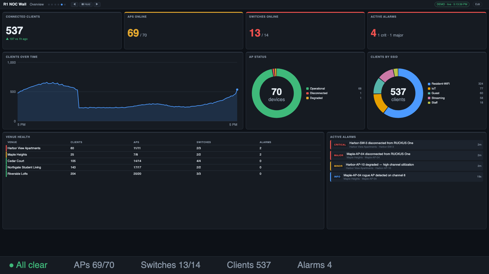

**Top bar:** dashboard title, current screen name, one dot per screen (click a dot to jump), the ◀ / ❚❚ Hold / ▶
controls, the view dropdown (if you have views), a data-source chip, the **Edit** link (only where editing is
allowed) and a clock. The controls fade away after a few seconds without mouse movement so a wall looks clean.

**Data-source chip:** green *live* = healthy. Amber = one or more sources had a problem (hover for details). A red
banner appears if all core data sources fail, or if no fresh data has arrived for a few poll intervals — so a frozen
wall can never look healthy.

**Bottom ticker:** scrolls live alerts first, then your custom messages and news / weather / quote feeds (see [Ticker, messages and feeds](#ticker-messages-and-feeds)); when there is nothing else it shows a one-line status (APs, switches, clients, alarms). Its text size is a setting.

### Keyboard and mouse

| Key | Action |
|---|---|
| `←` `→` (or Page Up/Down) | previous / next screen |
| `Space` | hold / resume rotation |
| `1`–`9` | jump to that screen |
| `F` | toggle fullscreen |

Clicking a **venue name** in a chart or table filters the whole screen to that venue — see
[Venue drill-down](#venue-drill-down).

### URL options

Add to the viewer URL, e.g. `http://server:8080/?screen=Switching&scale=1.25`.

| Option | Effect |
|---|---|
| `screen=Name` | show only that screen (no rotation) |
| `rotate=30` | rotate every 30 s (`0` = never) — overrides the layout |
| `hold=1` | start held (this browser only) |
| `view=Name` | show a specific [view](#views-and-schedules) |
| `display=2` | this browser is display 2 of a [multi-display wall](#multiple-displays-and-video-walls) |
| `sync=1` | follow the shared rotation clock (implied by `display=`) |
| `scale=1.25` | enlarge or shrink all text |
| `theme=light` | light theme (default is dark) |
| `ticker=0` | hide the bottom ticker |
| `mode=ticker` | full-screen scrolling-text sign (for a dedicated TV) |
| `guard=0` / `guard=1` | turn the burn-in guard off / on (on by default for `display=`) |
| `key=…` | the view key, if one is set |

---

## The editor

Open `http://localhost:8080/admin` (or click **Edit**). By default the editor works **only from the server itself**;
see [Security](#security) to allow it remotely.

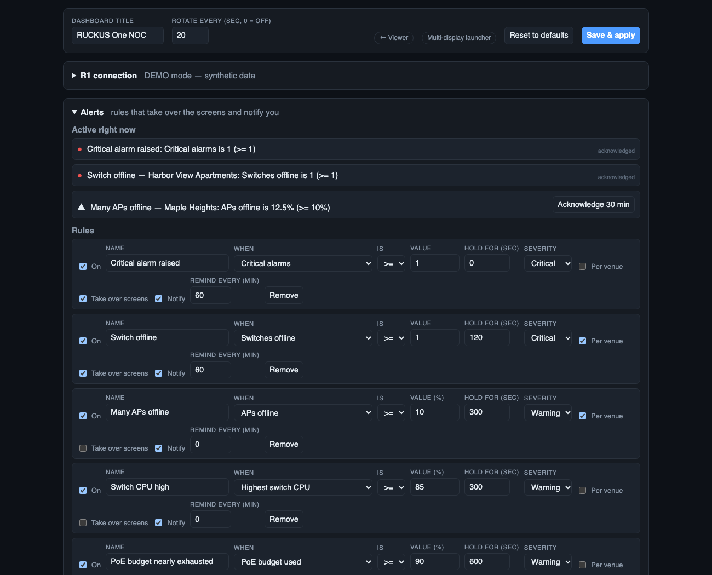

From top to bottom:

| Section | What it does |
|---|---|
| **Dashboard title / Rotate every** | title in the top bar; default seconds per screen (`0` = no rotation) |
| **Reset to defaults** | replaces all screens, views and schedules with the built-in three screens (asks first) |
| **Save & apply** | validates and saves the layout; every open display updates immediately |
| **R1 connection** | credentials, region, poll interval, **Test connection**, **Diagnostics** |
| **Alerts** | alert rules and the list of active alerts |
| **Display playlists** | which screens each monitor shows, in what order |
| **Notifications** | Slack / Teams / email / webhook channels |
| **Ticker & feeds** | scrolling messages, news, weather, stock quotes |
| **Reports** | scheduled report snapshots |
| **Schedules** | switch views by day and time |
| **Views / Screens** | the layout itself |

Nothing you change is live until you press the relevant **Save** button (each panel has its own).

### Duplicating, copying and renaming screens

Every screen has **⧉ Duplicate** (a copy right after it, named "… copy") and **Copy to** (pick Main or any saved view). Rename
a screen with the **Screen name** box. Copies are independent — their widgets and layout can be changed freely — and names
are kept unique within a view (playlists refer to screens by name). Every widget also has an optional **Card title** to
show instead of the widget's own name.

### Views, screens and widgets

- A **view** is a named set of screens. **Main** always exists.
- A **screen** is one page of widgets. Each screen has: a name, **Displays** (spread across 1–6 monitors), **Split**
  (auto/manual), **Auto-fit (no gaps)**, and Move ◀ ▶ / Delete.
- A **widget row** has: **Venue** (limit this widget to one venue), **Width** (1–12 columns), **Height** (rows),
  widget-specific options (e.g. *Show top*, *Hours*), **Amber/Red thresholds** (scorecards), and ↑ ↓ Remove.
- **+ Add widget** opens the catalog (below). **+ Preset screen…** adds a ready-made screen.

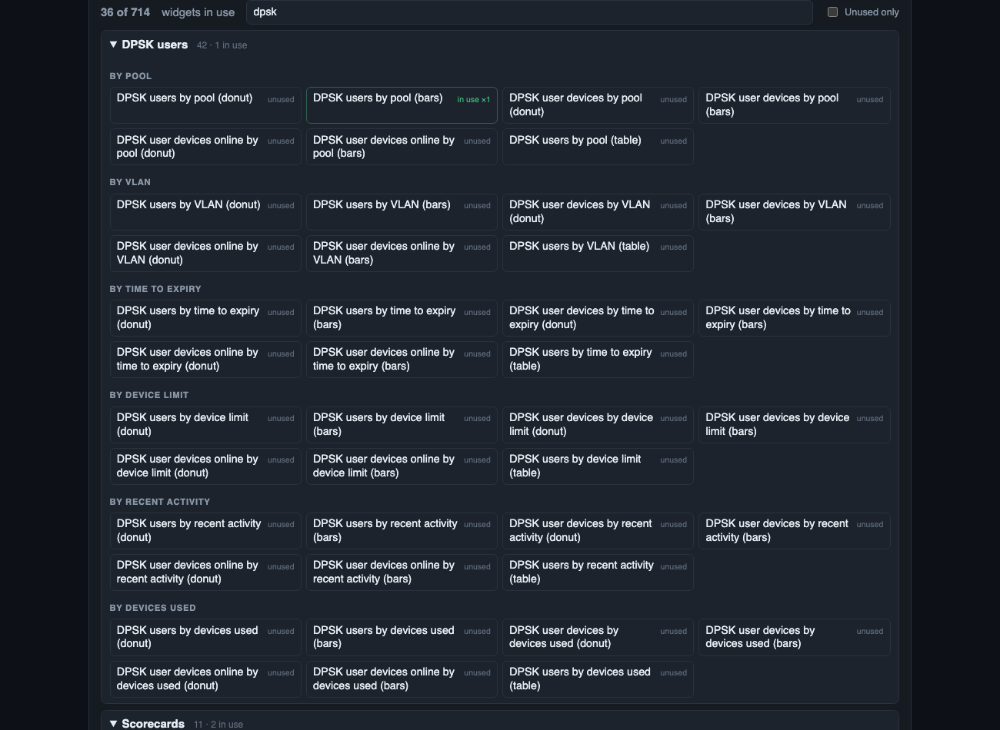

### R1 connection

| Control | Notes |
|---|---|
| Tenant ID, Client ID, Client secret | the secret is write-only — it shows *saved* afterwards and is never sent back |
| Region | fills the API and OAuth URLs; choose *Custom* to type your own |
| Poll every (sec) | 15–3600; lower = fresher but more API calls |
| **Test connection** | gets a token and lists your venues |
| **Diagnostics** | dumps what R1 actually returns (status values, field names, a sample row of each type) |

---

## Widgets

### The default screens (RUCKUS One look-alikes)

The three built-in screens are modelled on RUCKUS One's own pages:

| Default screen | Modelled on | Tiles |
|---|---|---|
| **Dashboard** | the R1 Dashboard | **Alarms** (ring by severity) · **Client Experience** · **Venues** (ring by status) · **Devices** (bars by status) · **Clients** · **Did you know?** · Venues table · Connected Clients Over Time · Top 5 SSIDs by Traffic / by Clients |
| **Wi-Fi** | the Wireless and WLAN reports | Top APs by Traffic / by Client Count · Top SSIDs by Traffic / by Client Count · Traffic Trend (downlink / uplink) · Active SSIDs Trend · Top APs and Top SSIDs tables |
| **Switch** | the Wired report | Top Switches by Traffic / PoE Usage / Errors · Traffic by Switch Model and Port Speed · Traffic Trend · Error Trend · Overview |

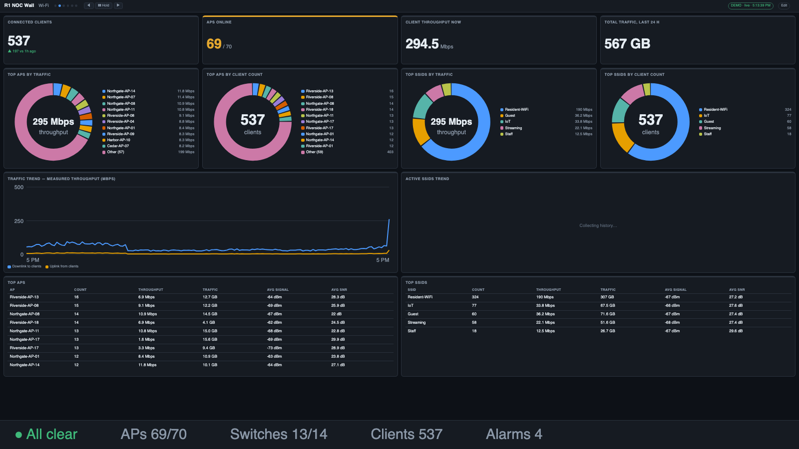
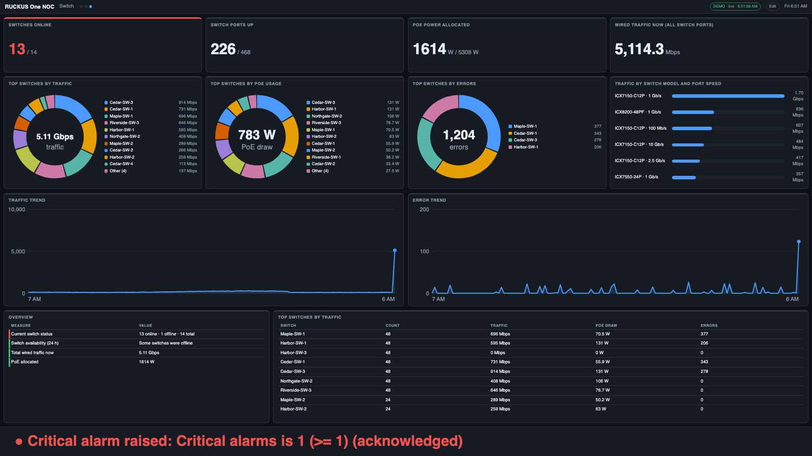

**What's different from R1:** the numbers come from R1's APIs, so a few tiles are omitted — *AP Capacity* and airtime.
*Connection Success*, *Time To Connect*, *Incidents* and *Top Applications* are included via R1's analytics service (experimental, see below). The map is
replaced by a Venues table. R1's "traffic over a period" is replaced by **measured throughput**: client throughput comes from
client byte counters, and switch traffic from switch-port counters, each differenced between polls (so switch traffic updates
every few minutes, when ports are refreshed, and the *Traffic Trend* charts fill in over time). The same screens are in the
**+ Preset screen…** menu as *RUCKUS One Dashboard / Wi-Fi / Switch*, so you can add them to an existing layout.

There are **1,000 widgets**, found in the picker under these groups. Use the search box — it matches title, group and
ID, so `dpsk`, `vlan`, `poe`, `ssid`, `guest`, `yesterday` all work. The tag on each button shows whether you already
use it (**in use ×2 · 1 here** / **unused**), and **Unused only** filters the list.

| Group | What's in it |
|---|---|
| **Clients, APs, Switches, Ports, Alarms** | every field you'd group by — SSID, OS, band, channel, manufacturer, model, VLAN, security, signal quality, firmware, status, venue… — as a **donut**, **bars**, or **table**, for counts and for measures like traffic, PoE draw, errors, average signal |
| **DPSK users, Guest users, Wi-Fi networks, Identity groups** | same idea for access/identity data: by pool, VLAN, expiry, type, status, network… |
| **Scorecards** | ~100 single numbers: clients per band, AP availability, switch CPU/memory highs, PoE budget, ports with errors, active/expiring DPSK users, active guests, VLANs in use… |
| **Trends** | any key metric over time, and category trends ("Clients by SSID over time") |
| **History** | now-vs-yesterday / last-week overlays, hour-of-day profiles, peak / average / change scorecards |
| **Gauges, RF** | dials for average signal and SNR per band, AP availability, PoE and CPU; RF-quality tables by venue / AP group / band; coverage-by-band tables filtered to AP groups (see below) |
| **AP load** | busiest radios, channel load, per-AP client/throughput table and congestion scorecards — stand-ins for airtime (see below) |
| **AP radios** | channel, band, channel width and TX power across all AP radios — the AP channel distribution |
| **Headline numbers, Breakdowns, Rankings, Lists & tables, Switching, Wi-Fi calling, Wi-Fi health, Client mix, DPSK, Guests, VLANs, Networks, Identity** | hand-built favourites: alarm and offline-device lists, venue health table, VLAN overview, DPSK pools, expiring-soon lists… |

**Reading a widget name.** *"Client traffic by SSID (bars)"* = the **measure** (client traffic) grouped by a **field**
(SSID), drawn as **bars**. *"Clients by SSID"* with no measure means a count. A *(donut)* shows the top few plus an
"Other" slice; *(table)* shows several measures side by side.

**Widget options.** *Show top* limits how many bars/slices/rows; *Hours* sets a trend window; *Rows* sets list length.

**Widget "kinds":** scorecard (one big number), donut, bars, table, list, line trend, multi-line trend, and hour-of-day
columns.

### Which data does each widget need?

Widgets that need heavier data (ports, DPSK, guests, networks, VLAN pools, identity groups, Wi-Fi calling profiles)
automatically switch that data source on while they're on a screen. The first poll after you add one can take a minute
to fill in. If a source fails, only the widgets that need it say so; the rest keep working.

### Throughput and traffic

RUCKUS One's public API reports each client's **cumulative bytes up and down for its current session**, but not a rate.
The server turns that into measured throughput: every poll it compares each client's counters with the previous poll,
and *bytes difference ÷ elapsed time* is that client's rate. Sum those and you have live throughput for the whole
network, a venue, a band, an SSID, an AP group…

- Each client keeps a **baseline** — its byte count and the time at the last moment the counter *changed*. When the counter
  changes again, rate = bytes moved ÷ time since that baseline. This matters because R1 may refresh client counters less
  often than the server polls: polls where the number hasn't moved yet are **not** treated as 0 Mbps — the last real rate is
  carried for up to 6 minutes, and only a client that stays unchanged longer than that counts as idle (0).
- The total rate never depends on R1's up/down split: if only the total is reported, you still get throughput (just no
  downlink/uplink breakdown for that client).
- Rates appear once a client's counter has changed at least once after the server first saw it (usually within a couple of
  minutes). A client with no MAC address, or one whose counters reset (it roamed or reconnected), simply restarts its baseline.
  Traffic from a client that disconnects between two polls is not counted, so totals are slightly conservative.
- The server records throughput and the bytes moved in every poll, so **"Total traffic, last 24 h / 7 days"**, up/down
  splits, peak throughput, and now-vs-yesterday comparisons all build up from the day you start it.

This approximates, but is not identical to, Data Studio's time-binned *Client Throughput* and *Traffic* charts: it is
**measured** between polls rather than R1's own estimate, and it only exists from the time the server has been running.

### AP groups, RF quality and gauges

- **AP groups.** The server reads your AP groups and attaches the group name to every AP and client (clients inherit
  the group of the AP they're on). That gives you the dimensions **AP group**, **venue / AP group**, **venue / AP group /
  band** and **venue / AP group / channel** on the client, AP and radio widgets.
- **"AP group contains" filter.** Client, AP, radio, gauge, scorecard and RF-table widgets have an **AP group contains**
  box in the editor (e.g. `public`, `guest`, `conference`). Only APs and clients whose AP group name contains that text
  (case-insensitive) are included — the same idea as Data Studio's *apGroupName ILIKE %text%*. Use it to build "Public
  coverage / Guest coverage / Staff coverage" panels.
- **Signal quality measures.** Besides counts, client widgets can show *average SNR*, *weakest signal* and *average time
  connected*. **RF quality by venue / AP group / band** is a ready-made table of clients, min/avg/max RSS, min/avg/max
  SNR and noise floor.
- **Gauges** are dials with coloured zones (green/amber/red): average signal and SNR (all bands, 2.4, 5, 6 GHz), poor-signal
  clients, AP availability, PoE budget, switch CPU and memory.
- **Hide Unknown.** Count, bar and donut widgets have a *Hide Unknown* option (set it to `1`) that drops the "Unknown"
  bucket — handy for client OS and manufacturer charts.
- **AP radios.** *AP radios by band / channel / width* shows how your channels and channel widths are actually
  distributed (including per venue / AP group), and average TX power.

> **Not available from the API:** airtime (busy / idle / utilization), per-application traffic, roaming-session counts,
> session duration history, MCS rates and AP receive failures. Those exist only in Data Studio. For airtime this has been
> checked directly: R1's built-in *Airtime* report is Data Studio dashboard #14403, and its API rejects API-key tokens
> (`The specified alg value is not allowed`), and none of the 31 published API specifications contains an airtime field.

#### Client experience — connection success and failure stages (experimental)

R1's own analytics service (the one behind its Client Experience and health reports) *does* accept an API-key token, even
though Data Studio doesn't. The server uses it to fetch, every 5 minutes and only while a widget needs it:

- **Connection success** (24 h) — successful vs attempted connections, overall and at each stage:
  **Association → Authentication → EAP → RADIUS → DHCP**. This is how you see *why* clients fail to connect — for example
  "association succeeds only 43% of the time" points at RF / capacity, while DHCP failures point at the network.
- **Time to connect** (average), **connection success over time** (15-minute, last 24 h), **daily success** (last 7 days),
  and **connected / newly connecting clients** over time.
- The **Client Experience** tile on the default Dashboard shows *Connection success* and *Time to connect* when this is available.
- A preset screen, **Connection health (experimental)**, groups them; the widgets are under **Client experience** in the picker.
- Alert rules can use **Connection success (24 h)** and **Average time to connect**.

**Top talkers and failures** (same service, 24 h, network-wide): top **applications** (by traffic and by clients), application
**categories**, and top **SSIDs / APs / clients** by traffic; plus **connection failures by SSID, AP and client maker** for each
stage, and a "who and where" table with the worst offender per stage. Preset: **Top talkers and failures (experimental)**.
The failure lists come back empty when there were no failures at that stage.

**Incidents** (R1's own Incidents page, last 7 days): open-incident counts, a table (severity, what, where, when, duration,
ongoing/cleared), and breakdowns by category, severity and type. An incident counts as *ongoing* if R1's window for it ended
less than 3 hours ago. Severity names (Critical ≥ 0.8, High ≥ 0.6, Medium ≥ 0.3, Low) approximate R1's P1–P4 bands. Preset:
**Incidents (experimental)**; alert rules can use *Open incidents* and *Open high/critical incidents*. **Airtime** is only
visible here as R1's "high airtime" incidents — the *Airtime incidents* tile shows how many R1 raised (zero simply means R1
raised none, not that airtime is fine). Impacted-AP/client detail is not available (R1 errors on it).

> **Experimental.** This service is not part of R1's published API. It may change or stop accepting API keys without notice.
> If it fails, only these widgets say so (the data-source chip turns amber and shows R1's error code); everything else keeps
> working. The figures are **network-wide** (no per-venue split yet), and R1's own *AP Capacity*, service-validation and call-quality (MOS) results were refused for API keys, so they are not included.

#### AP load — the closest stand-in for airtime

Airtime utilization measures how busy the *channel* is; the API can't tell you that, but it can show where the
**demand** is. The **AP load** group (and the preset screen **AP load (airtime stand-in)**) shows:

- **Busiest radios** — every AP radio with its band, channel and width, the clients on it, measured throughput, average SNR,
  share of poor-signal clients and TX power (clients are matched to a radio by their AP and band). Sort by clients or throughput.
- **Channel load** — per band / channel: how many radios share it, their clients and throughput, and clients per radio.
- **AP load** — per AP: clients on 2.4 / 5 / 6 GHz, throughput and SNR.
- **Scorecards** — most clients on one radio, radios with 20+ clients, average clients per active radio, and the most radios
  sharing one channel in a venue (co-channel density).

These are *indicators*, not airtime: a radio with many clients can be quiet, and a radio with few clients can be saturated by
one heavy user. Use them to spot likely hotspots, then check airtime in Data Studio.

---

## Auto-fit and layout

The grid is 12 columns wide. Each widget has a preferred **width** and **height**.

**Auto-fit (on by default, per screen)** keeps your widget *order* but tidies the layout so the screen has no holes:
widgets are grouped into rows, each row is stretched to exactly 12 columns, and every card in a row shares one
height. The whole screen is then scaled so it fills the display exactly — fonts grow or shrink to match.

- Put related widgets next to each other in the list; auto-fit never reorders them.
- A widget alone on its row fills the full width.
- A small scorecard sharing a row with tall charts is stretched to their height.
- Turn auto-fit **off** for a screen to use the exact widths and heights from the widget rows.
- Rule of thumb: **about 10–12 widgets per screen**. More than that and text gets small — add another screen instead.

Charts and lists never scroll: if a card is too short for all its rows, the last rows are dropped.

### Layout designer

Click **🎨 Design layout** on any screen to arrange it visually. The preview is drawn by the same code as the wall, so
what you see is what the display shows.

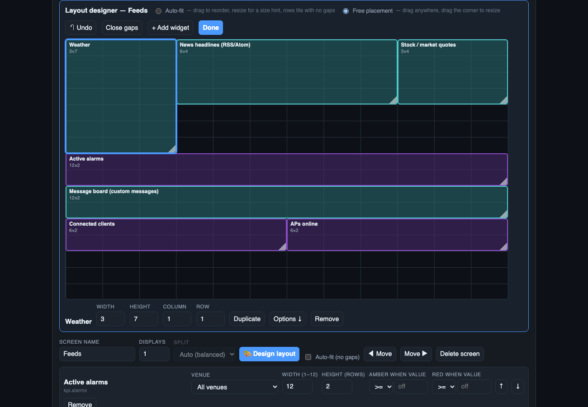

**Preview: Blocks / Chart previews.** The *Preview* menu in the designer's toolbar switches between plain labelled boxes and **chart previews** — each box shows its widget's real chart style (ring, bars, stacked bars, trend line, hour-of-day columns, gauge, table, list, scorecard…) filled with neutral placeholder numbers, never your data. It makes it much easier to judge how a layout will look before saving. Dragging, resizing, undo and the keyboard shortcuts all work the same in both modes, and your choice is remembered in this browser.

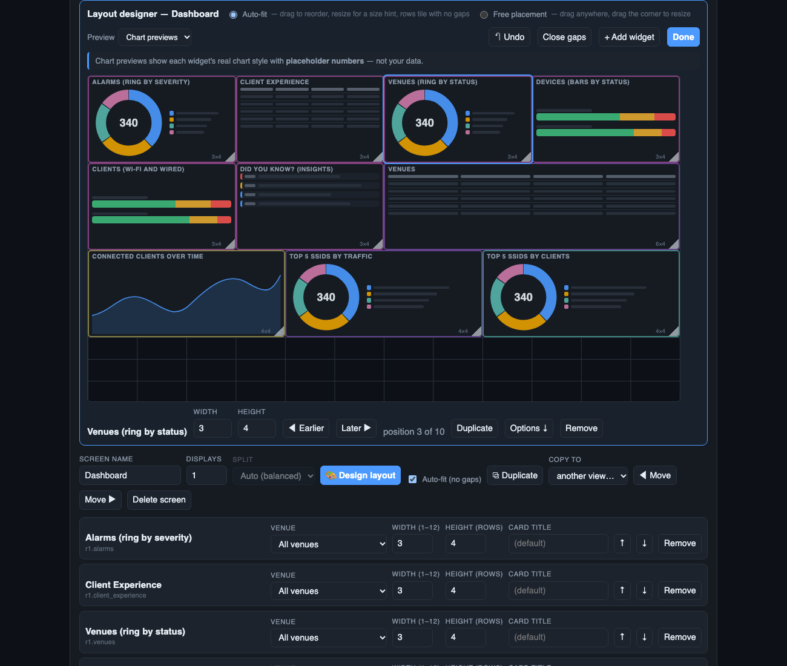

| Mode | How it works |
|---|---|
| **Auto-fit** | You choose the **order** by dragging a block over another, and give size hints by dragging its corner. The rows still tile with no gaps. |
| **Free placement** | Every widget has its own **column, row, width and height** on the 12-column grid. Drag blocks anywhere and drag the corner to resize. A block dropped on another pushes it down — nothing ever overlaps. |

- Click a block to select it: the strip underneath shows its width, height, column and row (type exact values), plus
  Duplicate, Remove and **Options ↓** (jumps to that widget's settings: venue, thresholds, "AP group contains"…).
- **Keyboard:** with the canvas focused, arrow keys move the selected block (or reorder it in auto-fit); **Shift**+arrows
  resize; **Delete** removes it.
- **↶ Undo** steps back through your last 30 changes. **Close gaps** (free placement) pulls everything up to remove empty rows.
- Switching **Auto-fit → Free placement** freezes today's tiling so nothing jumps; **Free → Auto-fit** keeps your reading
  order (top-to-bottom, left-to-right).
- **+ Add widget** opens the catalog; new widgets drop into the first free slot.
- A screen that is [spread across several displays](#multiple-displays-and-video-walls) lets each display tile its own
  share automatically; free placement applies when **Displays = 1** (or the screen is in a playlist).

The numeric Width / Height boxes on each widget row still work and stay in sync with the designer.

---

## Multiple displays and video walls

You can spread one screen across several monitors, each driven by its own browser (one PC with several monitors, or
a wall of small PCs).

1. In the editor, set **Displays** on a screen to 2–6.
2. Choose how to **Split**:
   - **Auto (balanced)** — widgets are cut, in order, into groups of similar total size.
   - **Manual** — each widget row gets a **Display** menu.
3. On each monitor, open `http://<server>:8080/?display=1`, `?display=2`, … (press `F` for fullscreen).

All displays share **one rotation clock on the server**, so they change screens together. `Space`, `←`, `→`, the
dots and the Hold button on **any** display control **all** of them.

- A screen with fewer displays than you have monitors is **mirrored** on the extras.
- Each display auto-fits its own widgets independently.
- **`/launch.html`** opens one window per monitor for you (it asks the browser for monitor positions where supported)
  and lists the per-display URLs to paste on other machines.

### Display playlists

Instead of splitting one screen across monitors, you can give **each display its own ordered list of screens** — e.g.
*display 1 rotates Overview → Clients → Switching; display 2 rotates Access → Infrastructure → History → Throughput*.

Open **Display playlists** in the editor (it edits the view you're on):

1. Set **Number of displays**.
2. **Tick several screens** in the list, choose a target display, and press **Add ticked screens to this display**.
3. Reorder with **↑ ↓**, remove with **✕**. Repeat for the other displays. A screen can appear in more than one playlist.
4. **Save & apply**, then open `/?display=1`, `/?display=2`, … on the monitors.

All displays still share one clock: they step, hold and jump together, but each cycles through *its own* list (a display
with 3 screens and one with 2 simply wrap at different points). A display with **no** playlist shows every screen.
Screens in a playlist are shown whole — the "spread across displays" split only applies to displays without a playlist.

---

## Views and schedules

A **view** is a complete alternative set of screens — e.g. *Main* for the day shift, *After hours* with just alarms
and offline devices, *Exec* with a few big numbers.

- **+ View** (in the editor) creates a view as a copy of the one you're editing. Rename it, change its rotation
  speed, edit its screens, Save & apply.
- Viewers can switch views with the **header dropdown** or `?view=Name`.
- **Schedules** switch the active view automatically:

  | Field | Meaning |
  |---|---|
  | Show view | which view |
  | From / To | time window; `18:00 → 06:00` runs overnight |
  | Days | which days the window **starts** on |
  | On | enable/disable |

  The first matching enabled schedule wins; if none match, **Main** shows. Times use the **server's local time**.
  A scheduled change re-syncs all displays.

---

## Thresholds

Any **scorecard** can be coloured by its value. In its widget row set **Amber when value** and/or **Red when value**
(e.g. *≥ 80* amber, *≥ 90* red) — leave a box blank to turn that level off. The card's top border and number change
colour. (For alerts that notify people, use [Alerts](#alerts-and-notifications).)

---

## Alerts and notifications

### Rules

Open **Alerts** in the editor. Each rule reads like a sentence:

> **When** *Switches offline* **is** *≥* **1** **for** *120 s* → **Critical**, **per venue**, **take over screens**, **notify**

| Field | Meaning |
|---|---|
| On | enable/disable the rule |
| When / is / Value | the metric and the comparison |
| Hold for (sec) | the condition must stay true this long before the alert fires (filters blips) |
| Severity | Warning or Critical |
| Per venue | evaluate separately for every venue (one alert each) |
| **Take over screens** | cover every display with a full-screen banner until acknowledged |
| **Notify** | send to your notification channels |
| Remind every (min) | repeat notifications while unresolved (`0` = once) |

**Metrics** include: critical / major / total alarms; APs offline (count and %); AP availability; switches offline;
highest switch CPU and memory; PoE budget used; connected clients; poor-signal client %; most clients on one AP;
err-disabled ports; ports with errors; DPSK users expiring in 7 days; guest passes expiring in 24 h; minutes since the
last good poll; core data sources failing.

An alert **resolves** by itself when its condition clears. Active alerts are listed at the top of the panel, each with
an **Acknowledge** button.

### Takeover

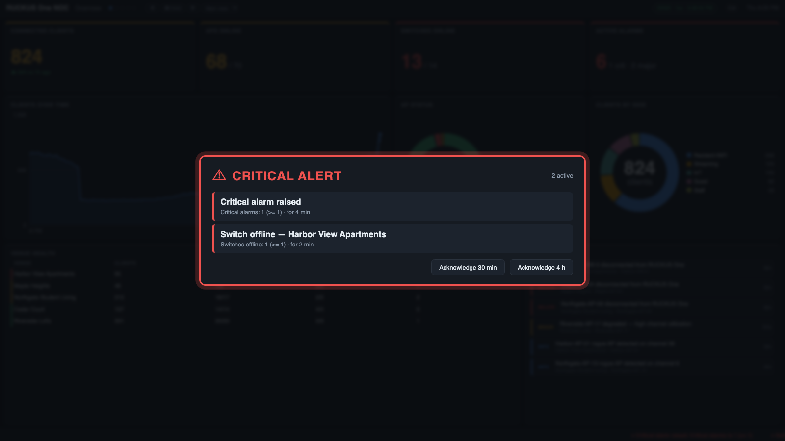

When a *Take over screens* alert is active, every display shows the banner and **rotation pauses**. Press
**Acknowledge 30 min** or **4 h** on any display to dismiss it everywhere; it reappears if still unresolved after the
snooze. The bottom ticker keeps acknowledged alerts visible.

### Notification channels

Open **Notifications**, **+ Add channel**, fill it in, **Send test**.

| Type | You need |
|---|---|
| **Slack** | an *incoming webhook* URL |
| **Microsoft Teams** | a Teams *webhook* URL |
| **Email (SMTP)** | host, port, security (STARTTLS 587 / TLS 465 / none), user, password, From, To (comma-separated). *Allow self-signed cert* helps with internal relays |
| **Generic webhook** | any URL; receives JSON: `event`, `severity`, `rule`, `venue`, `message`, `metric`, `value`, `threshold`, `since`, `text` |

Per channel: **Send from** (Warning and up / Critical only) and **Send "resolved"** messages. Secrets are stored on
the server (`data/notify.json`, owner-only) and never shown again — leave a secret box blank to keep the saved one.

> Alert *state* is held in memory. After a server restart, still-true conditions fire (and notify) again.

---

## Ticker, messages and feeds

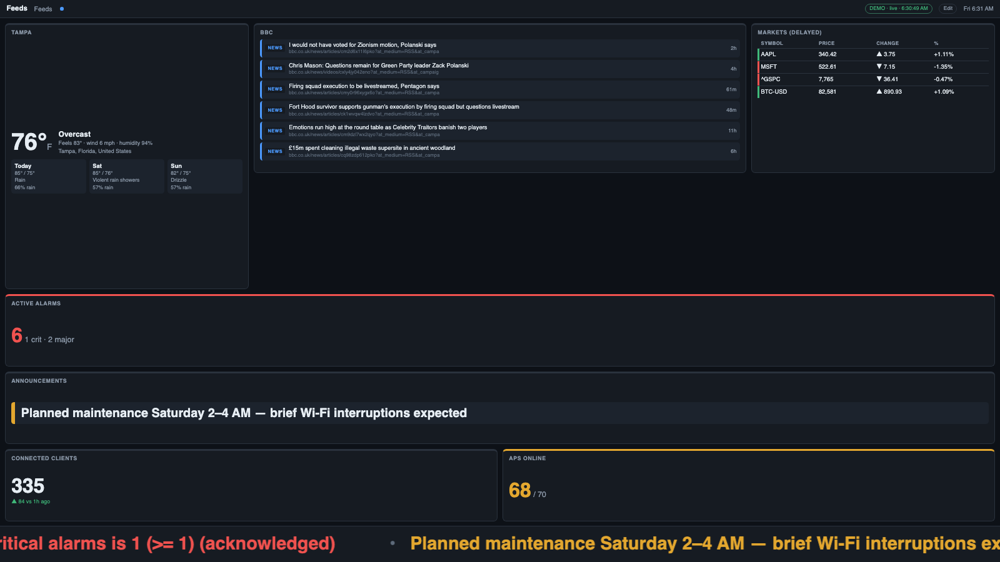

The bar along the bottom of every display scrolls **live alerts first**, then anything you've set up under **Ticker &
feeds** in the editor:

| Source | What it shows |
|---|---|
| **Custom messages** | your own text ("Planned maintenance Saturday 2–4 AM"), styled Normal / Good / Notice / Urgent, with optional *show from* / *until* dates (expired messages drop out by themselves) |
| **News (RSS / Atom)** | headlines from any feed URL, e.g. `https://feeds.bbci.co.uk/news/rss.xml` |
| **Weather** | current conditions and today's high/low for a place name (Open-Meteo, no key needed) |
| **Stock / market quotes** | price and % change since the previous close for stocks (`AAPL`), indices (`^GSPC`), FX (`EURUSD=X`) and crypto (`BTC-USD`) |

Each feed has its own refresh interval and a **Test** button that fetches it right away and shows a preview (a weather
test also shows which place it resolved to).

- **Text size** (Small / Medium / **Large** / Extra large) and **Scroll speed** are settings; the screen re-fits around the ticker.
- **All displays or different per display.** Every message and feed has **Show on: all displays** (the default) or a
  tick-list of specific displays, so a lobby TV can show the news and weather while the NOC wall shows an internal note.
  Under **Per-display settings** each display can also override the text size, scroll speed, whether messages and feeds
  show at all, and whether **alerts** are shown. *Hide alerts* removes them from that display's ticker **and** its
  full-screen takeover — meant for public-facing screens. (Turning messages & feeds *Off* while leaving alerts on gives an
  alerts-only ticker; set both to hide the strip entirely.) A viewer opened without `?display=` counts as display 1.
- **Full-screen sign:** `/?mode=ticker` turns a display into a giant scrolling-text board (alerts, messages, feeds) — handy for a lobby TV.
- **Widgets:** *Message board*, *News headlines*, *Weather* and *Stock / market quotes* cards are in the picker under
  **Ticker & feeds**, so the same content can sit on a normal screen too.
- Weather uses **Open-Meteo** and quotes use **Yahoo Finance's free chart service**. Quotes are delayed and the service
  is unofficial — it may change or stop working without notice. The server needs internet access to reach them; if a
  feed fails the others keep working and the editor shows the error.

---

## Venue drill-down

Click a **venue name** anywhere — a bar label, a legend entry, the first column of a table — and the entire screen
re-computes for that venue. A **Venue: … ✕** chip appears in the top bar (click it to clear). The filter is local to
that browser and clears itself after 90 seconds, so a wall never stays stuck on one venue. Widgets that aren't tied to
a venue (DPSK, guests, identity groups) are unaffected.

---

## History

The server records key numbers every poll (global and per venue) and keeps **30 days** in `data/history.db`. History
starts when you first run the server — trends and comparisons fill in over time.

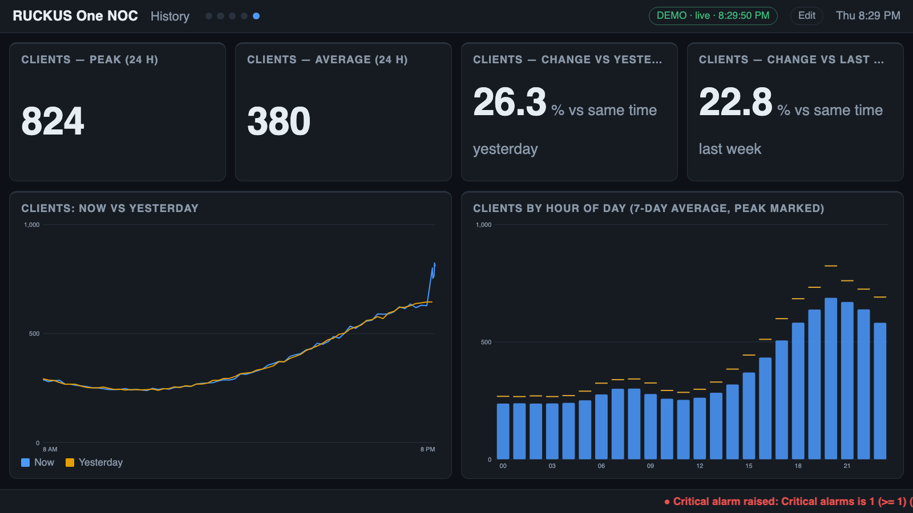

- **Trends** — a metric over a chosen number of hours; *by category* trends show the top few SSIDs, OSes, bands,
  models, etc. over time.
- **Now vs yesterday / last week** — today's curve overlaid on the same window a day or a week ago.
- **By hour of day** — 24 columns: the average for each hour over the last N days, with the peak marked.
- **Scorecards** — peak, average, low, 7-day peak, and % change versus the same time yesterday / last week.

Comparisons say *needs more history* until enough days have been recorded.

---

## Reports

Open **Reports** in the editor → **+ Add report**.

| Field | Meaning |
|---|---|
| View / Screen | which screen to snapshot (or *All screens*) |
| Every day / week, At | schedule (server local time; weekly picks a weekday) |
| Email it | send to every enabled email channel |
| **Run now** | generate immediately |

Each run saves an HTML file in `data/reports/` (newest 60 kept) and, if enabled, emails it (HTML + plain text).
Open any report in a browser at `/report?id=<id>`, or build one ad hoc: `/report?view=Main&screen=Overview`
(`screen=*` for all). Use the browser's **Print → Save as PDF** for a PDF.

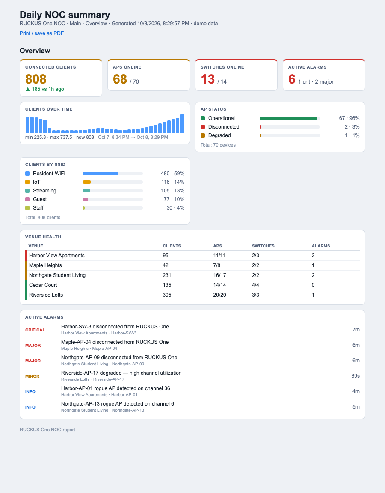

---

## Configuration

Settings come from environment variables, an optional `.env` file in the project folder, and the editor's
**R1 connection** panel. Values saved in the editor override `.env`.

| Variable | Default | Meaning |
|---|---|---|
| `R1_TENANT_ID` / `R1_CLIENT_ID` / `R1_CLIENT_SECRET` | — | RUCKUS One API application |
| `R1_API_BASE` | `https://api.ruckus.cloud` | API host for your region |
| `R1_OAUTH_BASE` | same as API base | token host |
| `PORT` | `8080` | HTTP port |
| `POLL_SECONDS` | `60` | poll interval (minimum 15) |
| `NOC_VIEW_KEY` | — | if set, every page/API needs `?key=` |
| `NOC_ADMIN_KEY` | — | allows the editor remotely, with `?key=` |
| `NOC_DEMO` | — | `1` = synthetic data, no credentials needed |
| `NOC_DATA_DIR` | `./data` | where settings, layout and history live |

### Files in `data/`

| File | Contents |
|---|---|
| `settings.json` | connection settings incl. the API secret (mode 600) |
| `dashboard.json` | your views, screens, widgets, schedules |
| `history.db` | 30 days of metric history (`history-demo.db` in demo mode) |
| `rules.json` | alert rules |
| `notify.json` | notification channels incl. secrets (mode 600) |
| `reports.json`, `reports/` | report definitions and generated reports |
| `ticker.json` | ticker options, custom messages and feed definitions (kept owner-only) |

**Back up** the whole `data/` folder. **Never commit it** (it's git-ignored).

---

## Security

| Setting | Effect |
|---|---|
| nothing set | anyone who can reach the port can **view**; the editor works **only from the server itself** |
| `NOC_VIEW_KEY=…` | viewers must add `?key=…` to the URL |
| `NOC_ADMIN_KEY=…` | the editor works remotely at `/admin?key=…` |

Other points:

- The server speaks plain **HTTP**. For anything beyond a trusted network, put it behind a reverse proxy (nginx,
  Caddy) that adds HTTPS.
- Secrets (API secret, SMTP password, webhook URLs) are stored in plain text in `data/` with owner-only permissions.
  Protect the server and its backups accordingly.
- Use a **read-only** RUCKUS One role for the API key (see below).
- A `?key=` in a URL can end up in browser history and proxy logs; for kiosks that's usually acceptable, for shared
  machines it may not be.

---

## Permissions and the API key

The server only **reads**: it posts *query* requests for venues, APs, switches, clients, alarms, ports, networks,
DPSK, guests, VLAN pools, identity groups and Wi-Fi-calling profiles. It never creates, changes or deletes anything in
RUCKUS One. Create the API key with the **read-only** role.

> Some R1 tenants may need a slightly broader role for certain *query* endpoints (they use `POST`). If **Test
> connection** reports `HTTP 403`, step the role up one level rather than jumping to administrator. If one widget
> reports a 403, only the sources that widget needs are affected.

---

## Running it permanently

These are **templates** — adjust paths. The server needs only Node and the project folder.

**Linux (systemd)** — `/etc/systemd/system/r1-noc.service`:

```ini
[Unit]
Description=R1 NOC
After=network-online.target

[Service]
WorkingDirectory=/opt/r1-noc
ExecStart=/usr/bin/node server.js
Restart=always
User=noc
Environment=PORT=8080

[Install]
WantedBy=multi-user.target
```

```bash
sudo systemctl enable --now r1-noc
```

**macOS (launchd)** — `~/Library/LaunchAgents/com.example.r1-noc.plist`:

```xml
<?xml version="1.0" encoding="UTF-8"?>
<!DOCTYPE plist PUBLIC "-//Apple//DTD PLIST 1.0//EN" "http://www.apple.com/DTDs/PropertyList-1.0.dtd">
<plist version="1.0"><dict>
  <key>Label</key><string>com.example.r1-noc</string>
  <key>WorkingDirectory</key><string>/Users/you/r1-noc</string>
  <key>ProgramArguments</key><array><string>/usr/local/bin/node</string><string>server.js</string></array>
  <key>RunAtLoad</key><true/><key>KeepAlive</key><true/>
</dict></plist>
```

```bash
launchctl load ~/Library/LaunchAgents/com.example.r1-noc.plist
```

Make sure the **display computers** don't sleep (disable display sleep / screensaver) and set the browser to open the
viewer URL in fullscreen on login.

---

## Troubleshooting

| Symptom | What to check |
|---|---|
| Chip says **connecting…** forever | the server isn't reachable from this browser (firewall, wrong address/port) |
| Red banner **"R1 API unreachable"** | credentials/region wrong or R1 down — open the editor, **Test connection** |
| Red banner **"DATA STALE"** | the server stopped getting data for several poll intervals; check the server's terminal output |
| Amber chip, "N source issues" | hover it: one source (e.g. `ports`) failed; widgets that don't use it still work |
| A widget is empty / zero | click **Diagnostics** — compare the status values and field names with what the widget expects |
| **Test connection → "did not issue a token"** | wrong Tenant ID / Client ID / secret, or wrong region |
| **Test connection → HTTP 403** | the API key's role is too restrictive for that query |
| Throughput shows *measuring…* | rates need two polls; if it never appears, run **Diagnostics** and check `clientTrafficSample` (clients need a MAC address and traffic counters) and `throughputEngine` (counts of clients tracked, changed, carried, idle, without a MAC or without counters) |
| Trend / history widgets say *collecting history* | they need a few polls (trends) or days (comparisons) of recorded data |
| Alert fired but no notification | the rule needs **Notify** ticked, and a channel whose **Send from** allows that severity; use **Send test** |
| Email test fails: *certificate* | tick **Allow self-signed cert** for an internal relay |
| Two displays out of step | they must both use `?display=N` (or `sync=1`); a plain viewer URL rotates on its own |
| Editor says *Read-only* / 403 | editing is localhost-only unless `NOC_ADMIN_KEY` is set; then use `/admin?key=…` |
| Port already in use | change `PORT`, or stop the other process |

Server logs go to the terminal (or the service log). Failed notifications and failed reports are logged there too.

---

## Limits and known gaps

- **Built against the API documentation; live-tenant tuning may be needed.** Core queries (venues, APs, switches,
  clients, alarms) follow shapes already confirmed on a live tenant. Several fields — client SSID/OS/band names,
  port status words, uptime format, DPSK/guest status values, AP group names, AP radio band strings — were mapped from the published schemas and should be
  confirmed once on your tenant with **Diagnostics**.
- No Data Studio content: application usage, Wi-Fi-calling call duration, airtime, roaming/session history, MCS rates and long-range history are not in the public API. Throughput and traffic are *measured* by the server between polls (see above) and only exist from first run.
- History begins at first run; weekly comparisons need a week of data.
- Alert state is in memory: restarting re-fires active alerts.
- One server process, one tenant. Large tenants (many thousands of ports/clients) make the first fetch slower; heavy
  sources are cached.
- Schedules and reports use the server's local time zone.
- The venue filter doesn't apply to DPSK, guests, networks or identity groups.

---

## Reference

### HTTP endpoints (for scripting)

All accept `?key=` when a view key is set. Those marked *admin* need localhost or the admin key.

| Endpoint | |
|---|---|
| `GET /api/config` | layout, scheduled view, shared clock state |
| `GET /api/data[?venue=id]` | computed widget payloads, alerts, summary |
| `GET /api/stream[?venue=id]` | server-sent events: `data`, `config`, `control` |
| `POST /api/control` | `{action: next|prev|goto|hold|resume, screen?}` — drives all synced displays |
| `POST /api/alerts/ack` | `{key, minutes}` |
| `PUT /api/config` | *admin* — save layout |
| `POST /api/config/reset` | *admin* — reset to defaults |
| `GET/PUT /api/rules`, `GET/PUT /api/notify`, `POST /api/notify/test` | *admin* |
| `GET/PUT /api/reports`, `POST /api/reports/run` | *admin* |
| `GET/PUT /api/ticker`, `POST /api/ticker/test` | *admin* — ticker, messages and feeds |
| `GET/PUT /api/settings`, `POST /api/settings/test`, `GET /api/diagnostics` | *admin* |
| `GET /report?id=…` | rendered report page |

### Project layout

```
server.js            HTTP server, SSE, shared rotation clock, scheduler
lib/collect.js       polls RUCKUS One, caches slow sources
lib/normalize.js     maps R1 rows to the app's field names (tolerant of variants)
lib/widgetgen.js     generates most of the widget catalog from tables of fields × measures × forms
lib/widgets.js       hand-built widgets + catalog
lib/rules.js         alert rules engine         lib/notify.js   channels + built-in SMTP client
lib/report.js        report renderer + schedule  lib/history.js  SQLite metric history
lib/feeds.js         messages, RSS/Atom, weather, quotes → ticker
public/layout.js     shared layout maths (viewer + designer)
lib/dashboard.js     layout validation, views, schedules
lib/demo.js          synthetic tenant for NOC_DEMO=1
public/              viewer (app.js), editor (admin*.js), launcher
```

### Adding your own widget

Append an entry to `lib/widgets.js` (or a field/measure to `ENT`/`M` in `lib/widgetgen.js`): a `type`, `title`,
`group`, default size, and a `compute(snapshot, venueId, params)` returning a payload of kind `kpi`, `donut`, `bar`,
`list`, `table`, `line`, `multiline` or `columns`. It appears in the editor's picker automatically.
